# 🛡️ Linkwache

**Check a suspicious link without opening it — in plain language, in eight languages, no sign-up.**

Paste a link (or the whole WhatsApp message), read the traffic light. Linkwache looks at the link
from the outside — domain age and owner, hiding behind Cloudflare, certificates, short-link targets,
imitated brand names, bait words, the fraud databases of Google Safe Browsing, URLhaus, PhishTank and
urlscan.io — and, if you want, a screenshot taken in the urlscan.io sandbox. The link is never opened
on the user's device.

> **⚠️ Please read before running this for others**
> Linkwache looks for *warning signs*; it does not prove that a page is harmless. A green result is
> "no warning signs found", never "safe". Brand-new scam sites are in no database for their first hours.
> If you host an instance publicly in Germany, you need an Impressum and a privacy page (templates in
> `src/render.js`, filled from environment variables) — and the third-party APIs it uses (Google Safe Browsing, urlscan.io, PhishTank) have their
> own terms; Safe Browsing in particular is licensed for non-commercial use only.

Deutsch · English · Türkçe · Polski · Русский · Español · Français · Italiano — the language is picked
from the browser, a switch is in the header, and a shared result link renders in the reader's language.

## Hosting

Two ways to run it, same code: a **Cloudflare Worker** (KV, Email Routing) or **self-hosted** as a
Node 22 container behind any reverse proxy (`server/index.js`, `Dockerfile`, `deploy/nas/`). The
Impressum/privacy pages take their personal data from environment variables, never from the repo.
A live instance run by the author for friends: https://linkwache.example.org

## Ways in

| Channel | How |
|---|---|
| **Web** | paste → check. Works for every messenger and mail client. |
| **Desktop app** (Windows, macOS, Linux) | checks every clicked link automatically before it opens — see [Desktop protection](#desktop-protection). |
| **Browser extension** (Chrome, Edge, Brave, Firefox, Safari) | checks links clicked in webmail and on web pages. |
| **Android app** | checks every tapped link automatically before it opens — see [Android](#android) below. |
| **Android share sheet** | add the page to the home screen once; it then appears under "Share". |
| **iPhone** | a signed one-tap Shortcut (`/kurzbefehl.html`) puts it in the share sheet. |
| **E-mail** | forward the suspicious mail to `pruefen@<your domain>` (Cloudflare Email Routing → this Worker; Cloudflare variant only). |
| **Telegram** | forward the message to your bot. |

## Android

**Every link you tap is checked before it opens** — in mail, messengers, text messages, PDFs.
The app becomes your phone's default browser app, checks each link and hands it to your real
browser. No warning signs: it opens right away. Suspicious: a warning with the reasons, "Open
anyway" only after three seconds. Dangerous: blocked, opening only through a deliberate second
step. Server unreachable: "Could not be checked" — nothing opens by itself.

<p>
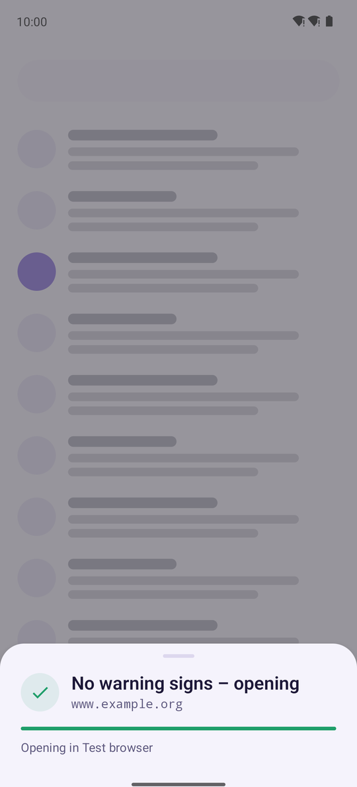
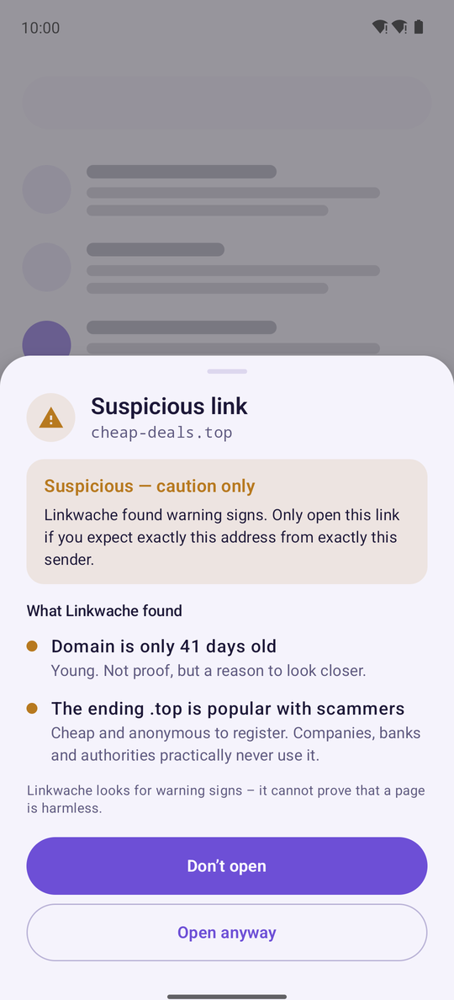
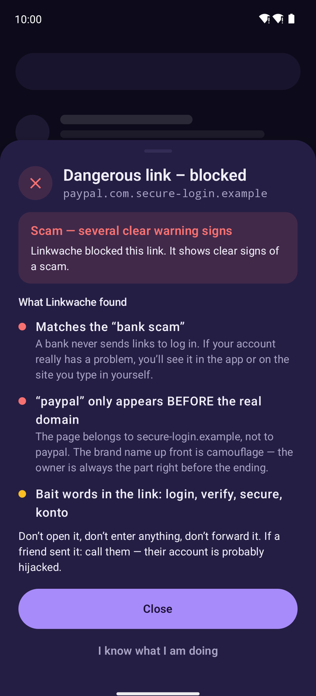
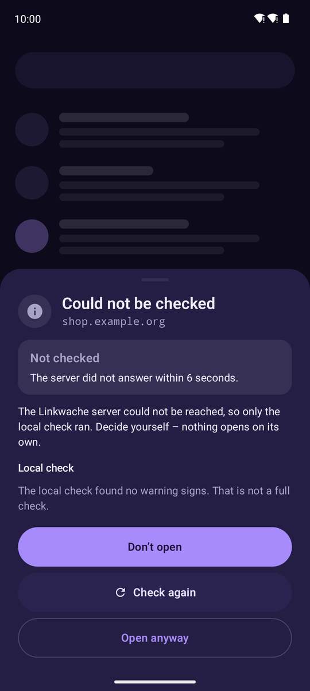
</p>
<p>
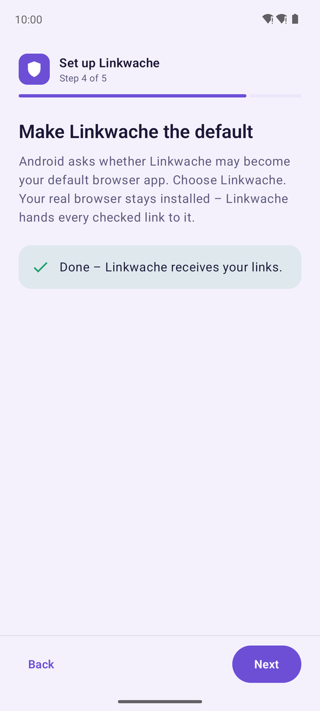
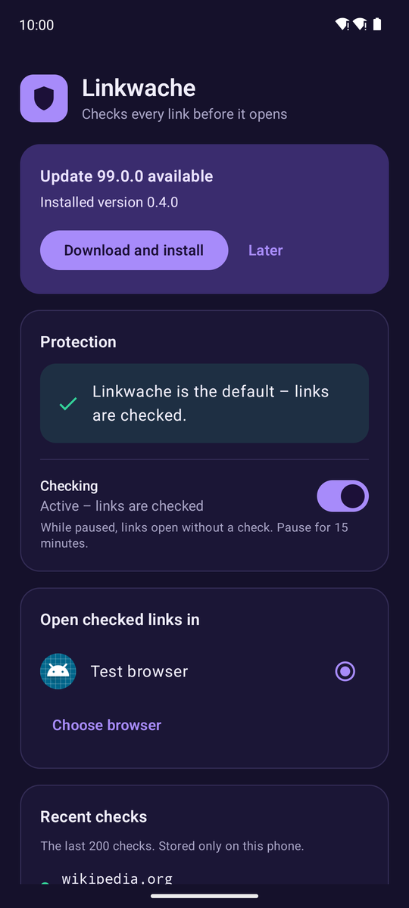
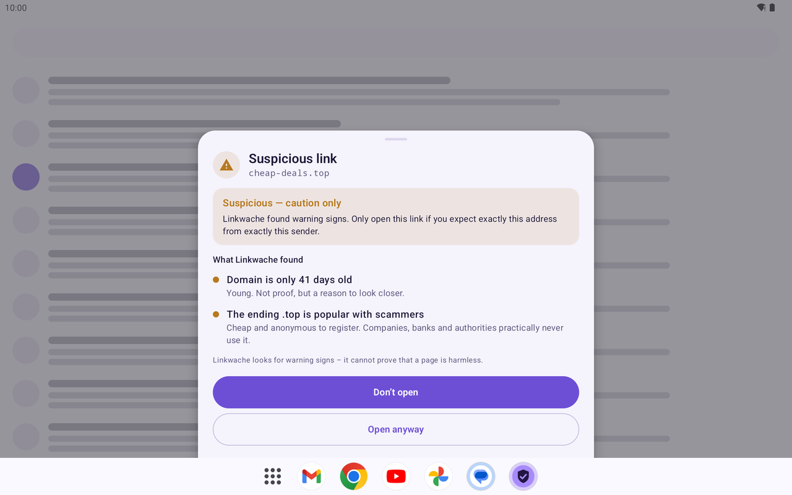
</p>

**Install** (no app store for now — every release carries the signed APK; scan to open the latest release on your phone):


1. Download `Linkwache-android-X.Y.Z.apk` from the [latest release](https://github.com/robeertm/linkwache/releases/latest)
   (or the `/download` page of a Linkwache site) and compare its SHA-256.
2. Open it and allow **"Install unknown apps"** for your browser or file manager when Android asks
   (only for this installation), then tap *Install*.
3. Open Linkwache and follow the five setup steps. In step 4 choose **Linkwache as default browser
   app** in Android's dialog (or *Settings → Apps → Default apps → Browser app*). Your previous
   browser stays installed and receives every checked link.

Only the address and path go to the server — the part after `?` and `#` stays on the phone (or
just the domain, if you prefer). History stays on the device. The app looks for updates itself
and installs one only after checking its SHA-256 and signing certificate, with your confirmation.

Android limits: links opened inside an app's own built-in browser and verified app links never
reach the default browser — use *Share → Check with Linkwache* there. Details, build and signing:
[docs/ANDROID.md](docs/ANDROID.md).

## Desktop protection

**Every link clicked anywhere on the computer is checked before it opens** — in the mail program,
office documents, PDFs, messenger apps. The desktop app (Windows 10/11, macOS 12+, Linux x64/arm64)
becomes the system's handler for web links, checks each link and hands it to your real browser.
The browser extension covers what never leaves the browser: links in webmail and on web pages.

- **No warning signs:** a small notice "Linkwache is checking … *domain*" turns into "No warning signs –
  opening" and the link opens in your browser (known and cached links in well under a second).
- **Suspicious:** a warning with the findings in plain language; "Don't open" is the main button,
  "Open anyway" becomes active after three seconds.
- **Dangerous:** blocked. Opening needs a deliberate second step ("I know what I am doing" → confirm)
  and is written to the local history.
- **Server unreachable:** "Could not be checked" with the local assessment — nothing opens by itself.

<p>
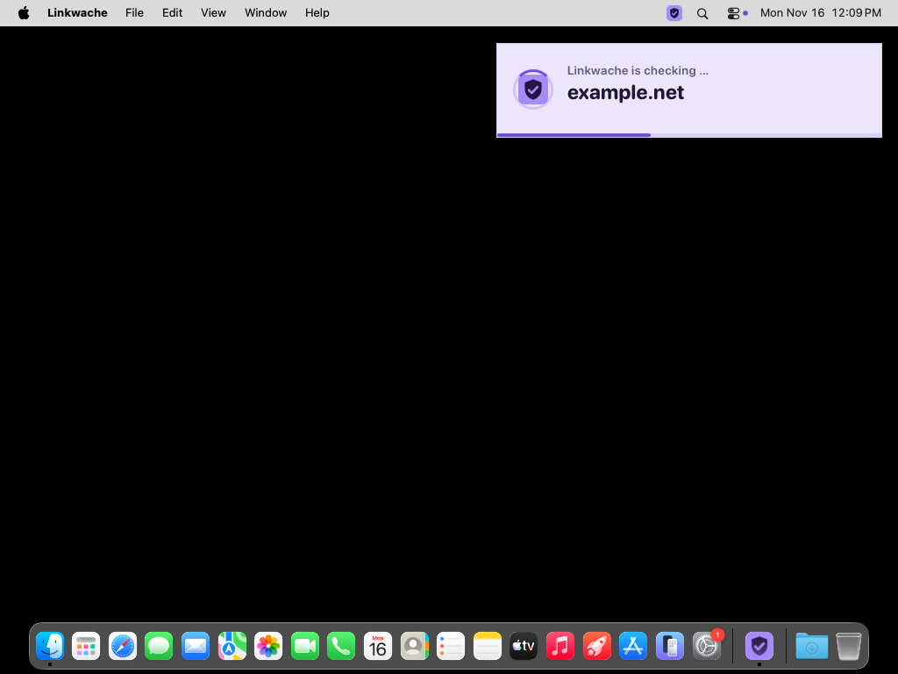
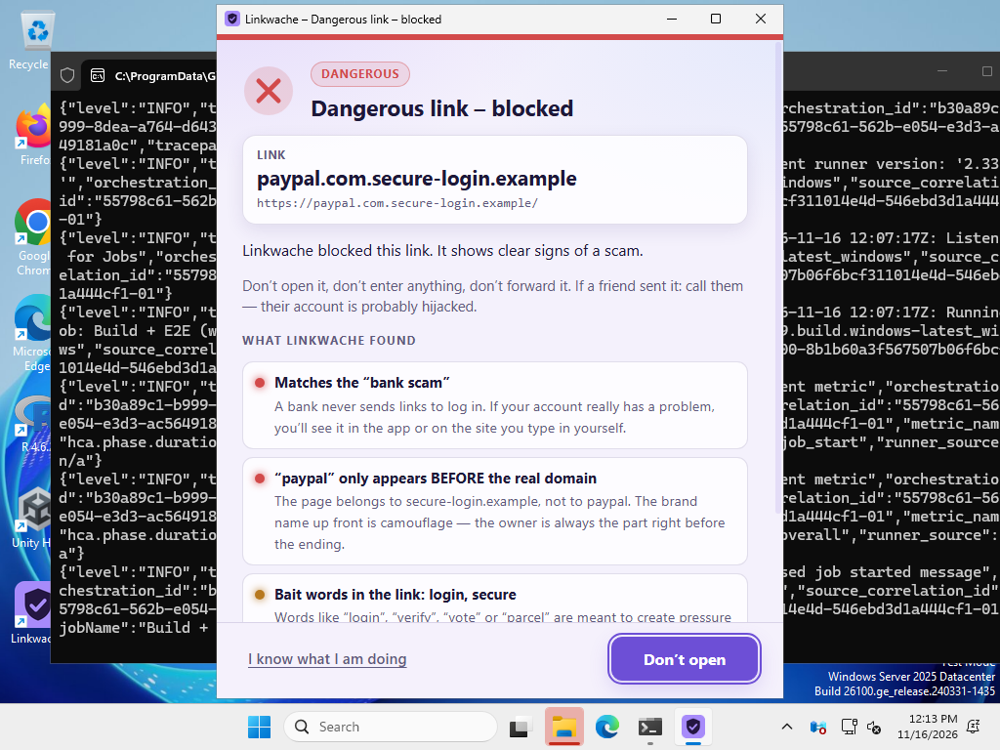
</p>
<p>
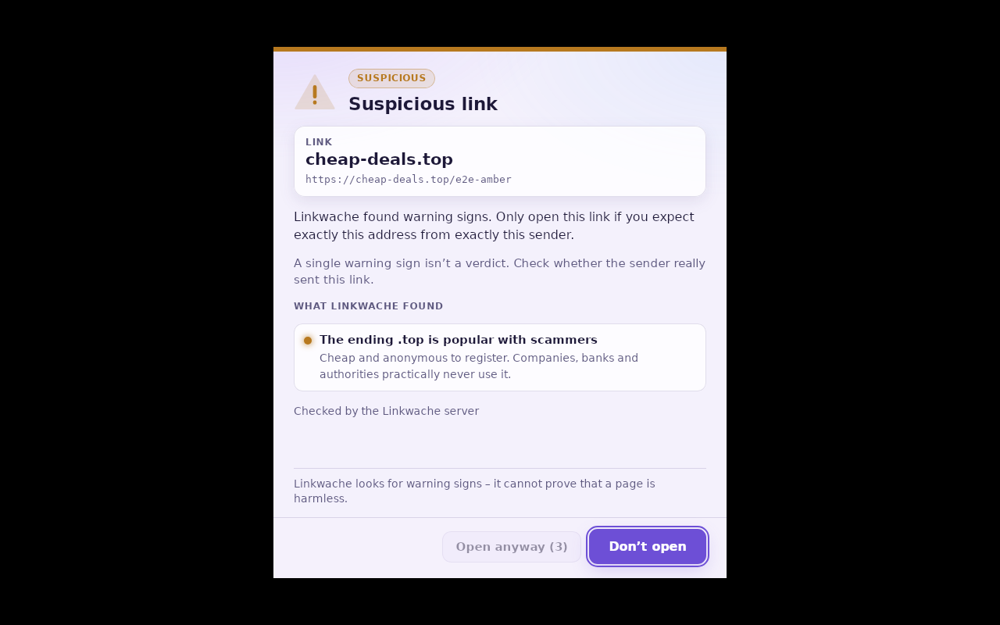
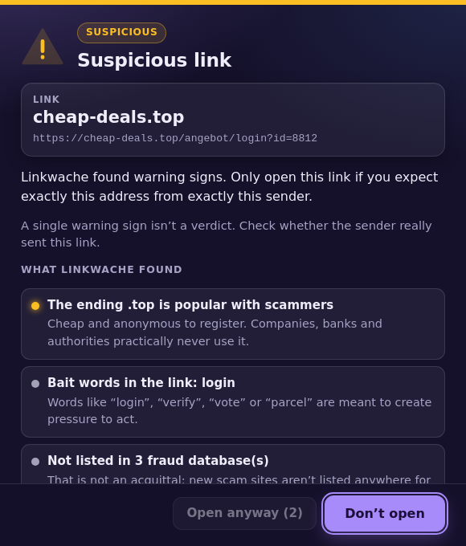
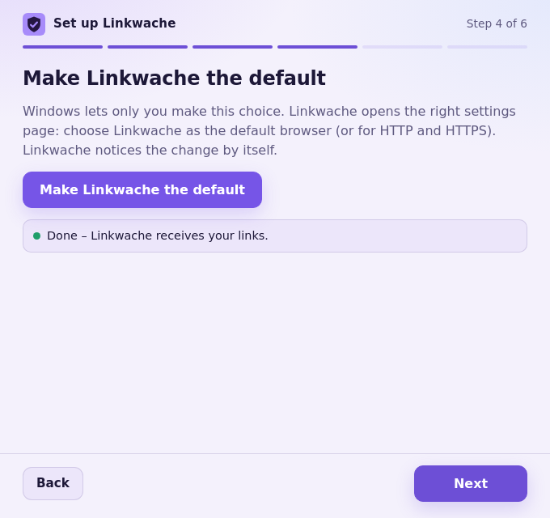
</p>
<p>
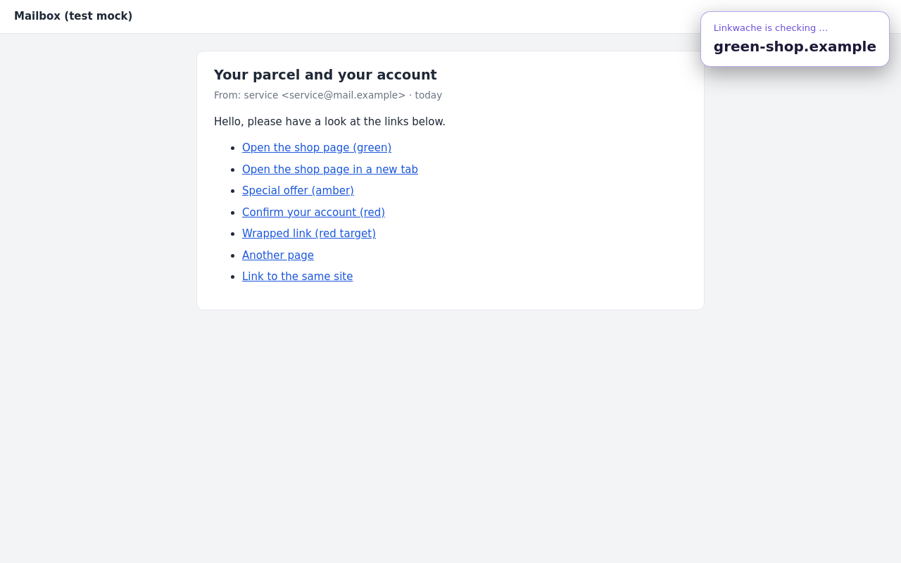
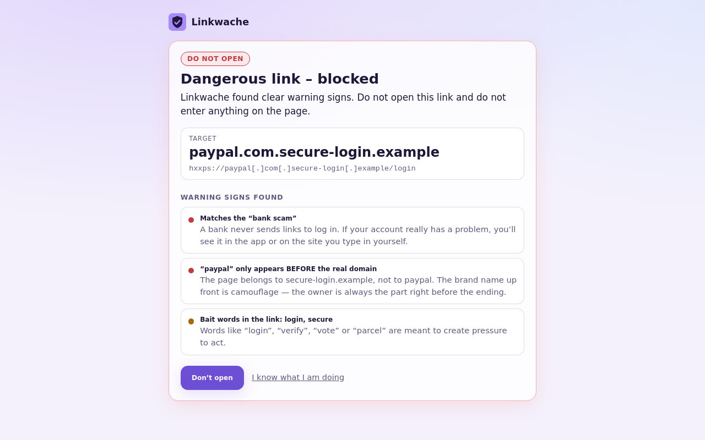
</p>

**Install** (no app stores for now): download the package for your system from the `/download`
page of a Linkwache site or the [latest release](https://github.com/robeertm/linkwache/releases/latest)
and compare its SHA-256 (`SHA256SUMS.txt`).

| System | Package | First start |
|---|---|---|
| Windows | `Linkwache_X.Y.Z_x64-setup.exe` (per user, no admin) or `.msi` | not code-signed yet: SmartScreen → *More info* → *Run anyway*. The assistant opens *Default apps*; choose Linkwache for HTTP/HTTPS — Windows lets only you make that choice, Linkwache notices it. Managed PCs: [`docs/windows-default-associations.xml`](docs/windows-default-associations.xml) (DISM/GPO). |
| macOS | `Linkwache_X.Y.Z_universal.dmg` | not notarised yet: right-click → *Open*. Confirm "Use Linkwache" when macOS asks about the default browser. |
| Linux | `.AppImage` (self-updating), `.deb`, `.rpm` (x64 and arm64) | the assistant sets the default via `xdg-settings` and checks it. |
| Extension | `linkwache-extension-chromium-X.Y.Z.zip` / `-firefox-` | Chrome/Edge/Brave: unzip, `chrome://extensions` → Developer mode → *Load unpacked*. Firefox: `about:debugging` → *Load Temporary Add-on* (until a signed version exists). |
| Safari (Mac) | build it yourself: `safari/scripts/build-local.sh` | Safari loads extensions only from a Mac app, and a downloadable one needs a paid developer account. With Xcode and your free Apple ID the script builds "Linkwache for Safari" in a few minutes; then Safari → *Settings → Extensions* → tick Linkwache. Details, the variant without an Apple ID and the limits: [docs/DESKTOP.md#safari](docs/DESKTOP.md#safari). |

The setup assistant remembers your previous browser and forwards every checked link to it — never
back to the system default, so links cannot loop. Only `http`/`https` links are checked; other
schemes are never taken over. The app and the extension share one cache and allowlist through
native messaging when both are installed; each also works alone.

**Privacy:** checks run on the device first (allowlist with look-alike protection, cache, offline
heuristics, unwrapping of mail link wrappers such as Safe Links). Only scheme, host and path go to the
server — never the part after `?` or `#` (or just the domain, if you prefer). The server does not
store these checks. History stays on the device; no telemetry.

**Updates:** the app looks for new releases itself (switchable), shows a notice in the tray and
installs with one click after verifying the update signature, keeping a backup of the previous
version; settings, allowlist and history stay. Design and API: [docs/DESKTOP.md](docs/DESKTOP.md),
[docs/API.md](docs/API.md); building and signing: [desktop/README.md](desktop/README.md).

## Reserve server (fallback)

The apps (desktop app, browser extension including Safari, Android app) can switch to a **reserve server** when
the main server is unreachable (timeout, no connection, server error). The reserve is the same check code
(`src/reserve.js`) as a Cloudflare Worker that serves only the app API, with nothing stored (no KV, logging off).
It is used only with the built-in server address; a user who entered an own server never uses it. The full
contract (when to switch, time budget, switching back) is in [docs/FALLBACK.md](docs/FALLBACK.md).

- **Build variable:** `LINKWACHE_FALLBACK_SERVER` (e.g. `https://<name>.<account>.workers.dev`), read at build time
  like `LINKWACHE_DEFAULT_SERVER`; in CI the repository variable of the same name. Empty = no reserve.
- **Deploy:**
  ```
  npx wrangler deploy -c deploy/cloudflare/wrangler.toml
  npx wrangler secret put SAFE_BROWSING_KEY -c deploy/cloudflare/wrangler.toml   # optional, recommended
  ```
  Free plan: 100,000 requests a day; one check is one request plus about eight sub-requests (limit 50).
  Without an interactive login: `deploy/cloudflare/deploy.sh --subdomain <name> --set-repo-variable <owner>/<repo>`
  with an API token (template "Edit Cloudflare Workers") in `~/.config/cloudflare/token` (0600); it registers the
  workers.dev subdomain if the account has none, deploys, optionally sets the Safe Browsing secret (`SB_KEY_CMD`),
  checks the reserve and sets the repository variable.
- **Watchdog:** a monitor can probe the reserve with `"probe": true` (see [docs/API.md](docs/API.md)).
- **Privacy:** only while the main server is down, the app sends the same check request to the reserve (link
  reduced as usual, language, scope, random installation id, app name/version); Cloudflare technically also sees the
  device's IP address. Nothing is stored there; rate limits use hashed in-memory keys. Cloudflare acts as processor;
  the privacy page of the site describes it.

## Stack

One Cloudflare Worker (`src/index.js`) with static assets, a KV namespace for results (90 days,
random IDs, no personal data), a rate limit keyed on a daily-salted hash of the IP, an Email Worker
handler and a Telegram webhook. No cookies, no analytics, no server to maintain.

```
src/checks.js   heuristics + lookups (DNS over HTTPS, RDAP, crt.sh, Safe Browsing, URLhaus, PhishTank, urlscan.io)
src/verdict.js  scoring, known scam patterns (voting, parcel, bank)
src/i18n.js     every user-facing string in eight languages; findings are stored as keys and translated at render time
src/render.js   pages, result card, text for bot and mail
public/         styles, client script, share-target manifest (the Impressum and privacy pages are in src/render.js)
test/           node --test
```

## Run locally

Needs Node 22 or newer. `npm test` also expects `git` and `unzip` on the PATH (the packaging and updater tests call them); on a minimal image such as `node:22-slim`, install both first.

```
npm install
npm test
npx wrangler dev        # http://localhost:8788 — network lookups are live, sandbox/Safe Browsing need keys in .dev.vars
```

## Deploy

See **[SETUP.md](SETUP.md)** — a step-by-step guide (Cloudflare account, domain, KV, secrets, Email
Routing, Telegram bot, Safe Browsing and urlscan keys, PayPal button, Impressum).

## License

Source-available — see [LICENSE](LICENSE). All rights reserved; free to run for yourself, not to
redistribute or host for others without permission. Third-party components and their licences are
listed in [THIRD-PARTY-NOTICES.md](THIRD-PARTY-NOTICES.md) (generated by `scripts/drittlizenzen.py`,
checked by a test; the container image, the desktop packages and the APK carry it together with
`LICENSE`).

All product and company names mentioned in this project are trademarks or registered trademarks of
their respective owners. Their use here is for identification only and does not imply any
affiliation, endorsement or sponsorship.

## Updating (self-hosted)

Set `ADMIN_TOKEN` (e.g. `openssl rand -hex 24`) to enable the operator page at `/admin`: it shows the running version,
whether a newer release exists, and files an update request with one click. The page installs nothing; on the host run

```
LINKWACHE_NAS=user@host scripts/aktualisieren.sh              # latest release
LINKWACHE_NAS=user@host scripts/aktualisieren.sh --if-requested  # only when requested on /admin (cron-friendly)
```

The script verifies the release (tag matches `package.json`, tests pass), backs up the running version and rolls back
automatically if the health check fails. Turn the daily release lookup off with `UPDATE_CHECK=off`.

### Usage figures

The self-hosted build keeps aggregated usage figures (requests by group, checks by channel, verdicts, response times,
busiest minute, CPU time, approximate senders per day; no addresses or links) in `data/metrics.json`. The operator page
shows them after signing in; `GET /api/stats` returns them as JSON for dashboards with the read-only `STATS_TOKEN`
(or `ADMIN_TOKEN`). See [docs/STATS.md](docs/STATS.md).
