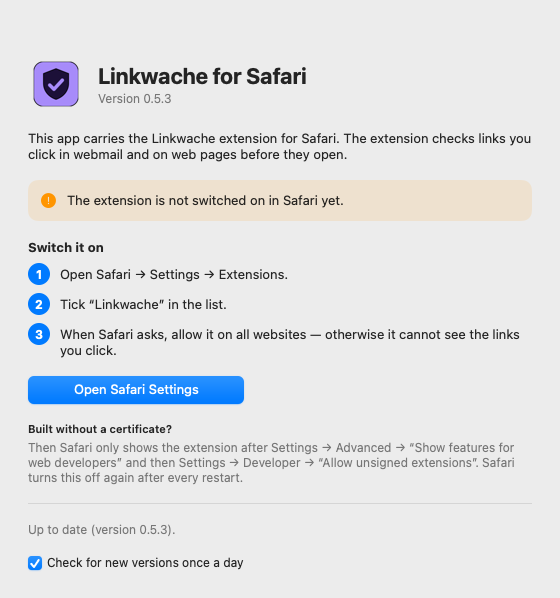
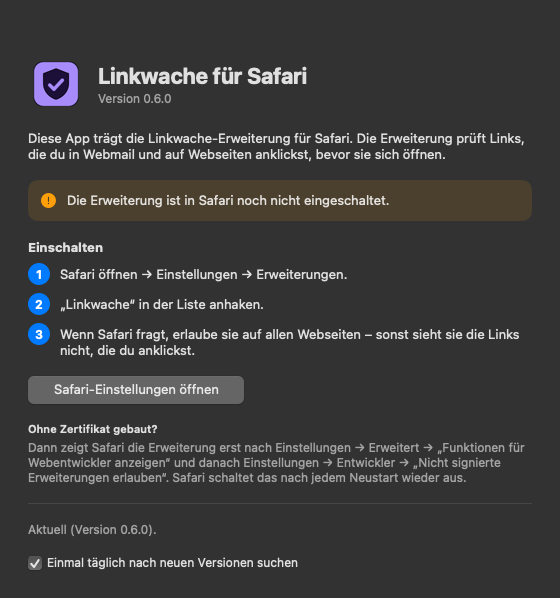
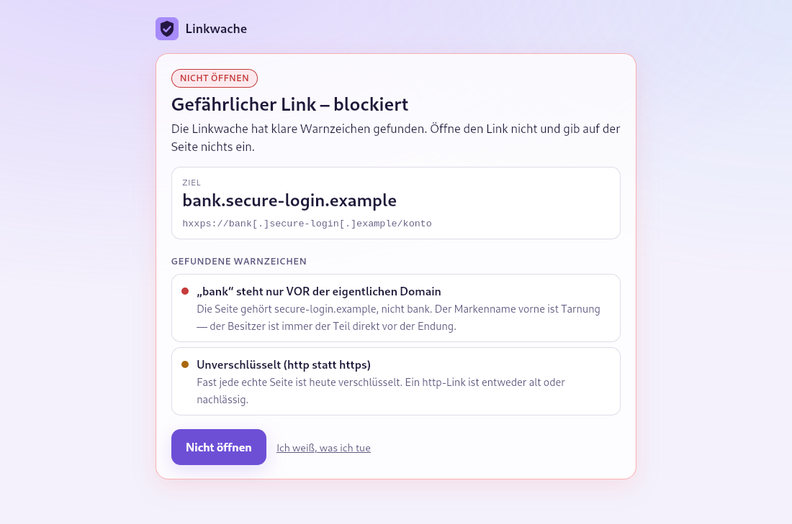
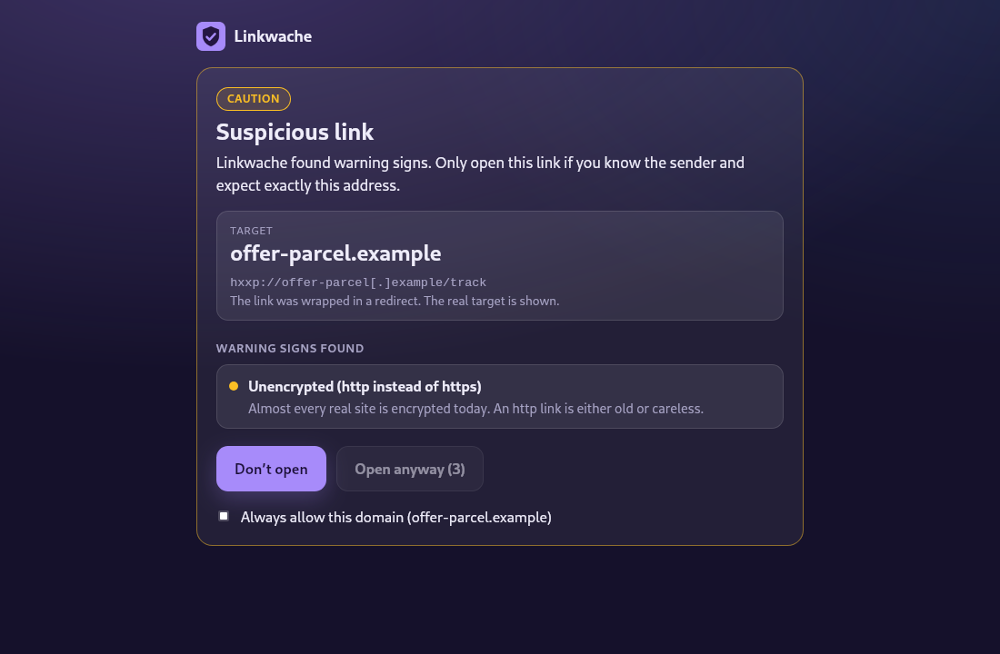
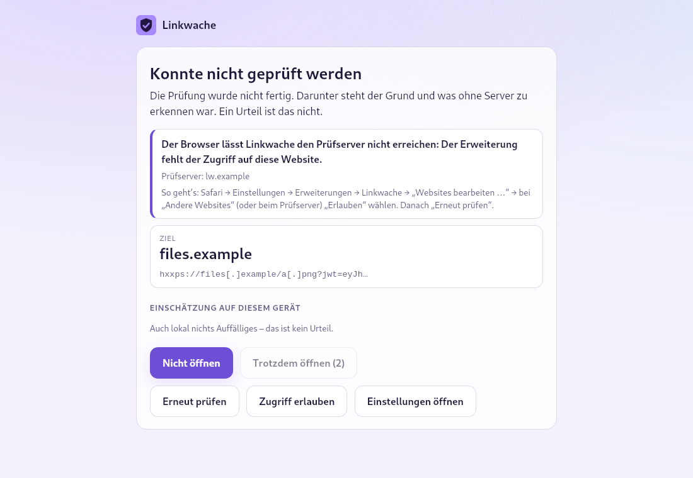
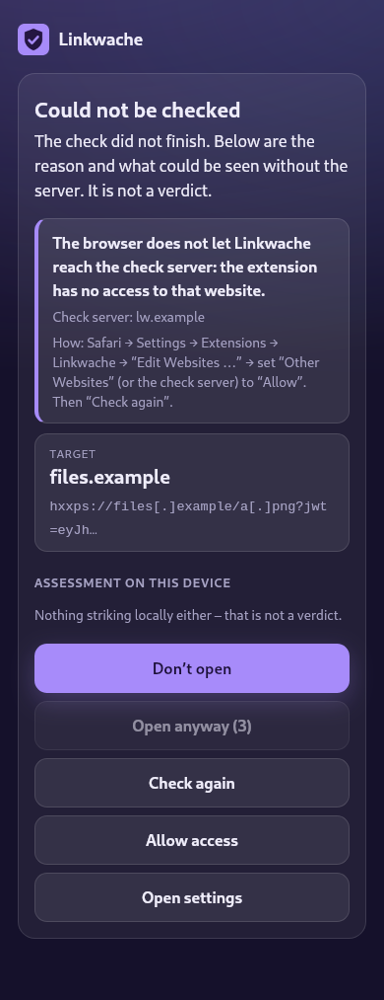

# Linkwache Desktop — design and build plan

Status: phase 1 built (version 0.5.0). This document is the contract between
the desktop app, the browser extension and the server. Change it first, then the code.

## 1. Goal

Every link a person clicks anywhere on their computer — in a mail client, an office document,
a PDF, a messenger, or inside the browser (webmail) — goes through the Linkwache **before** it
opens, without any extra step:

- no warning signs: the link opens immediately in the user's real browser;
- suspicious or dangerous: an understandable warning appears instead of the target page;
- the user always sees *that* a check runs and *what* the result is.

Wording rule (applies to every text in every language): Linkwache never says a link is "safe".
It says "No warning signs found". It finds warning signs; it cannot prove innocence.

| Level  | Colour | Short text (en)                   | Action                                   |
|--------|--------|-----------------------------------|------------------------------------------|
| gruen  | green  | No warning signs – opening        | toast for ~0.8 s, then open              |
| gelb   | amber  | Suspicious                        | warning window, "Don't open" is primary; "Open anyway" enabled after 3 s |
| rot    | red    | Dangerous – blocked               | warning window, nothing opens; opening only via a deliberate second step ("I know what I am doing" → confirm), logged locally |
| offline| grey   | Could not be checked              | window with the local assessment; user chooses; never opens silently |

## 2. Components

```
                ┌──────────────────────────────┐
  click in mail │ OS default http/https handler│ = Linkwache Desktop (Tauri 2)
  office, PDF ─▶│  1. unwrap known redirectors │
                │  2. allowlist / cache        │──── forward ───▶ user's real browser
                │  3. local heuristics         │
                │  4. POST /api/v1/check ──────┼──▶ Linkwache server (self-hosted)
                └──────────────▲───────────────┘
                               │ native messaging (optional)
  click inside  ┌──────────────┴───────────────┐
  the browser ─▶│ Browser extension (MV3)      │──── same API when the app is absent
  (webmail)     └──────────────────────────────┘
```

- `desktop/` — the desktop app (Rust + system webview via Tauri 2), one code base for
  Windows 10/11, macOS 12+, Linux (x86_64 and arm64).
- `extension/` — one Manifest V3 code base for Chromium browsers (Chrome, Edge, Brave), Firefox
  and Safari (see [Safari](#safari)).
- `safari/` — the Xcode project of the Safari container app "Linkwache for Safari", built by the
  user on their own Mac (no developer account needed).
- `server/` + `src/` — the existing service, extended by `POST /api/v1/check`.

### Why Tauri 2

Small installers (a few MB instead of ~100 MB for Electron), one code base, a built-in signed
updater, tray icon, autostart and single-instance plugins, and a Rust core where the
security-relevant decisions (loop guard, scheme filter, timeouts, cache) are unit-testable with
`cargo test`. The UI is plain HTML/CSS/JS without a bundler, so it can also be rendered in a
normal browser for screenshots and visual tests.

## 3. Intercepting links outside the browser

The app registers as an http/https handler in the "browser picker" pattern. On first run the
setup assistant records the previous default browser as the **forward target** (changeable in
settings) and then asks the operating system to make Linkwache the default.

### macOS
- `Info.plist` declares `CFBundleURLTypes` for `http` and `https` and the app as a browser
  (`LSHandlerRank`), so it shows up in System Settings → Desktop & Dock → Default web browser.
- The assistant calls `LSSetDefaultHandlerForURLScheme` for `http` and `https`; macOS asks the
  user once to confirm. The assistant then re-reads `LSCopyDefaultHandlerForURLScheme` and shows
  whether it worked.
- URLs arrive as Apple Events (`RunEvent::Opened`), also while the app is already running.
- Forward: `open -b <bundle id of the saved browser> <url>` (never plain `open <url>`).

### Windows 10/11
- The installer registers Linkwache as a browser candidate under HKCU (per-user install, no
  admin): `Software\RegisteredApplications`, `Software\Clients\StartMenuInternet\Linkwache\
  Capabilities\URLAssociations` (`http`, `https` → `LinkwacheURL`), ProgID
  `Software\Classes\LinkwacheURL\shell\open\command` = `"…\Linkwache.exe" "%1"`.
- Windows protects the real default (`UserChoice` carries a hash; since 2024 also the UCPD
  driver), so **only the user may set it**. The assistant opens
  `ms-settings:defaultapps?registeredAppUser=Linkwache` with a short illustrated instruction and
  then checks `HKCU\…\UrlAssociations\https\UserChoice\ProgId` itself until it reads
  `LinkwacheURL`.
- Managed PCs: an XML file for default associations (`docs/windows-default-associations.xml`)
  for `Dism /Online /Import-DefaultAppAssociations` or the Group Policy "Set a default
  associations configuration file".
- URLs arrive as command-line arguments; the single-instance plugin hands them to the running
  instance.
- Forward: the saved browser's `shell\open\command` from
  `Software\Clients\StartMenuInternet\<browser>` (HKCU, then HKLM), started directly with the URL
  as one argument — never `ShellExecute(url)` (that would call Linkwache again).

### Linux (GNOME, KDE, Xfce, others following freedesktop)
- `linkwache.desktop` with `MimeType=x-scheme-handler/http;x-scheme-handler/https;text/html;`
  (`text/html` because `xdg-settings` expects a browser to open HTML files; they pass through)
  and `Exec=linkwache %u`.
- The assistant reads `xdg-settings get default-web-browser` (saved as forward target), then
  runs `xdg-settings set default-web-browser linkwache.desktop` (fallback
  `xdg-mime default linkwache.desktop x-scheme-handler/http x-scheme-handler/https`) and
  verifies with `xdg-settings check`.
- Forward: launch the saved `.desktop` entry (`gio launch` / `gtk-launch`, or its parsed `Exec`
  line) — never `xdg-open <url>`.

### Loop and bypass protection
- The forward target can never be Linkwache itself (checked by bundle id / executable path /
  desktop file id when saving and again before every launch). If it is, the assistant asks
  for a browser instead of forwarding.
- A forwarded launch carries no Linkwache marker that a page could abuse; there is no "skip
  check" URL parameter.
- Only `http` and `https` links are checked. Local HTML files (some systems only list an app
  as a browser if it also opens `.html` files) are handed to the saved browser unchanged — they
  have no network target. Anything else (`mailto:`, `tel:`, `javascript:`, `data:`, `ms-…:`,
  custom schemes) is never registered and, if it ever arrives, is refused with a short message
  — Linkwache does not launch it.
- Known redirectors are unwrapped locally before the check, so the real target is judged:
  Outlook Safe Links (`*.safelinks.protection.outlook.com/?url=`), Google (`google.*/url?q=`),
  Facebook (`l.facebook.com/l.php?u=`), Instagram (`l.instagram.com/?u=`), YouTube
  (`youtube.com/redirect?q=`), Slack, LinkedIn (`linkedin.com/safety/go?url=`). URL shorteners
  are resolved by the server exactly as on the website.

## 4. Inside the browser: the extension

Links clicked in webmail never reach the OS handler, so the extension covers them.

- A content script listens in the capture phase for clicks (left, middle, Ctrl/Cmd, Enter) on
  `<a href>` with an `http(s)` target on **another site** than the current page. It stops the
  navigation, shows an in-page toast "Linkwache is checking … <domain>" (shadow DOM, so pages
  cannot style or read it), and asks the service worker.
- green → navigate exactly as the click intended (same tab / new tab / background tab);
  amber/red/offline → open the extension's warning page (`warning.html`) in that tab.
- Fallback for navigations started by scripts: `webNavigation.onBeforeNavigate` for top-level
  frames whose domain is in the local "red" cache redirects to the warning page; red results
  are also added as `declarativeNetRequest` session rules so a known-bad domain is blocked
  before it loads.
- Talks to the desktop app over **native messaging** (host name `app.linkwache.desktop`) so both
  share one cache, allowlist and server setting; without the app it calls the server API
  directly (server address set in the options page).
- Same visual language and the same 8 languages as the app.

## 5. Check flow and speed

Target: under 1 s from click to open for clean, known links.

1. Normalise; refuse non-http(s); unwrap redirectors (section 3).
2. **Allowlist:** domains the user approved, plus a short built-in list of very large sites
   (search engines, major webmail/office suites, video, encyclopedias). Match on the
   registrable domain only (`accounts.example.com` → `example.com`) and never on look-alikes:
   IDN/punycode hosts, digit-for-letter swaps and hyphenated brand names never match the
   allowlist. An allowlisted click still shows the green toast.
3. **Cache:** previous server verdicts per registrable domain + path hash; green for 6 h, amber
   and red for 24 h (server may send `cacheTtl`). Cache lives only on the device.
4. **Local heuristics** (ported from `src/checks.js`: IP host, `@` in URL, IDN, plain http,
   odd port, risky TLD, brand in subdomain / brand typo, many subdomains, shortener). A local
   red is shown immediately as red; the server call still runs for the details.
5. **Server check** with a hard timeout (default 6 s). On timeout / no network / server error →
   "Could not be checked" with the local assessment; never opened silently.

Shared test vectors (`test/vectors/heuristics.json`) are run by both the JavaScript tests and the
Rust tests so the port cannot drift from the server.

## 5a. Reserve server

When the main server fails for real (timeout, no connection, status 500 or higher, an error page that is not JSON,
a 2xx that is not a v1 answer), the check goes to a reserve server with the same request. The reserve address is
baked in at build time (`LINKWACHE_FALLBACK_SERVER`, empty = none) and used only while the effective server is the
built-in one; a user's own server never gets a reserve. Time budget: main 4.5 s, reserve `min(6 s, 8 s - elapsed)`,
whole check at most 8 s. The main server is remembered as down for 5 minutes (shared by all checks while the app
runs); meanwhile a background thread probes `GET /api/health` at most once a minute to switch back. An answer from
the reserve is marked `via: "reserve"` and the result window shows the quiet note "Checked via the reserve server".
Logic: `desktop/core/src/failover.rs` (tests with a fake backend and a fake clock). Contract: [FALLBACK.md](FALLBACK.md).
The browser extension (incl. Safari) follows the same contract in `extension/src/failover.js`.

## 6. Privacy

- Local checks first. The server only receives what it needs.
- Default: the client sends `scheme://host[:port]/path` — **query string and fragment are
  removed** (that is where tokens, mail addresses and session ids usually live). Setting
  "Domain only": the client sends `https://host/` only (fewer findings, maximum privacy).
- `/api/v1/check` results are **not stored** on the server (no result page, no id) and the
  installation id is only used, hashed with the day, as a rate-limit key.
- Installation id: 128 random bits created on first run, no personal data, can be reset in
  settings.
- Local history (last 200 checks) stays on the device and can be cleared; no telemetry.
- The privacy policy (8 languages) describes the desktop app and the extension.

## 7. Server API

The contract for `POST /api/v1/check`, limits and the native-messaging protocol is in
[API.md](API.md) (shared with the Android app).

## 7a. Download page

`/download` on the Linkwache site (server-rendered like the other sub-pages, 8 languages,
light/dark, phone width). It detects the visitor's system and suggests the matching package;
all packages stay visible: Windows (NSIS `.exe`, `.msi`), macOS (`.dmg`), Linux (AppImage,
`.deb`, `.rpm`), browser extension for Chromium and Firefox (load-it-yourself with step-by-step
instructions) and the Android APK ("being prepared" until the release carries one).

- Files are **assets of the GitHub release** of the public repository; the page links them, so
  the self-hosted server carries no download traffic.
- Version, date and SHA-256 per package come from the existing daily release query
  (`server/update.js`, asset `digest`, fallback `SHA256SUMS.txt` asset) — never hard-coded.
- Unsigned Windows build: the page explains with a screenshot how to pass the SmartScreen
  notice ("More info" → "Run anyway") and shows the checksum next to it.
- The home page carries a quiet hint "Protect automatically: app for your computer / phone".

## 8. Updater (from day one)

- Tauri updater plugin; the update manifest `latest.json` and the signed artefacts are attached
  to the GitHub release. Signatures use a minisign key pair: the public key is compiled into the
  app, the private key exists only as a CI secret and offline backup — never in the repository.
- Check on start and every 12 h (can be switched off in settings). The tray and the settings
  window show "Update x.y.z available" with a one-click "Install and restart".
- Before replacing: signature check (plugin), copy of the running executable/bundle to
  `<app data>/backup/<version>/`, settings/allowlist/history stay in the app config directory
  untouched. After restart the new version writes `last-good-version`; if the new version fails
  to start three times, the assistant offers the backup.
- Packages: Windows NSIS (per-user) and MSI, macOS DMG (+ app tarball for the updater), Linux
  AppImage (self-updating) plus `.deb`/`.rpm` (update notice points to the package).

## 9. Build, sign, release

- GitHub Actions (`.github/workflows/desktop.yml`) builds on `windows-latest`, `macos-latest`
  (universal), `ubuntu-22.04` and `ubuntu-22.04-arm` (glibc 2.35, so the Linux packages also run on
  Debian 12 and other older distributions); runs `cargo test`, the end-to-end test and
  takes native screenshots. Tag builds attach all artefacts + `latest.json` to the release
  draft/pre-release; the release broker promotes.
- macOS signing and notarisation need the maintainer's Developer ID — a manual step on the
  maintainer's Mac until a CI secret is provided. Builds are unsigned otherwise.
- Windows: shipped unsigned for now (SmartScreen warns on first start; the download page
  explains it). Updates are still safe: the updater verifies the minisign signature of every
  update before it replaces anything — independent of Authenticode.
- Extension: `extension/dist/chromium.zip` and `extension/dist/firefox.zip`, loadable unpacked;
  store submission is a later phase. Safari: built locally from `safari/` (see [Safari](#safari)); the
  `Safari` workflow builds and checks it on a macOS runner and keeps the ad-hoc signed app as an artifact.

### Windows code signing later

The workflow already contains the hook: when the repository secret `WINDOWS_SIGN_MODE` is set
(`pfx` with `WINDOWS_CERT_PFX` + `WINDOWS_CERT_PASSWORD`, or `azure` for Azure Trusted Signing
with `AZURE_CLIENT_ID`/`AZURE_TENANT_ID`/`AZURE_CLIENT_SECRET` + account/profile names), the
Windows job signs the `.exe`, `.msi` and the bundled binary with `signtool` (timestamped) before
the updater signature is computed. Without the secret the step is skipped. Nothing else changes.

## 10. Tests

- `npm test`: server API (contract, limits, foreign origins, no storage), heuristics vectors,
  i18n completeness (every language has every key used by app and extension).
- `cargo test`: URL normalisation, scheme filter, redirector unwrapping, allowlist look-alikes,
  cache, loop guard, heuristics vectors, updater backup logic.
- End-to-end on real systems in CI: register the handler, open a green and a red test link via
  the OS (`start`/`rundll32 url.dll,FileProtocolHandler` on Windows, `open` on macOS,
  `xdg-open` on Linux), with a local Linkwache server and a fake "real browser" that records
  what it was asked to open. Expected: check window appears, verdict matches, green reaches the
  fake browser, red does not; server down → "Could not be checked", nothing opens.
  Test links never use real scam addresses (`*.example`, `*.test`, brand-in-subdomain
  constructions on reserved names).
- Extension: Playwright with the unpacked extension (Chromium; Firefox via web-ext), clicks on
  green and red links in a webmail mock page.
- Visual: screenshots of every state (checking/green/amber/red/offline, setup assistant, tray
  menu, extension warning page) in light and dark, desktop and phone width.

## 11. Phases

Phase 1 (this release): server API, download page, desktop app for all three systems (intercept, check window,
warning window, tray, setup assistant, updater, CI builds, end-to-end), extension for Chromium
and Firefox. The Android app is built in parallel in `android/` (separate task) against
the same API and appears on the download page once a release carries the APK.

Later phases (planned, not built):

| # | Phase | Needs | Estimate |
|---|-------|-------|----------|
| 2 | Signed builds: macOS notarisation in CI, Windows code signing (hook ready) | Developer ID secret, certificate | 0.5 day |
| 3 | Store submission: Chrome Web Store, Edge Add-ons, Firefox AMO (for now: download page) | developer accounts | 1 day + review time |
| 4 | Safari extension (Safari Web Extension in an Xcode wrapper) — **built in 0.6.0 as the free, build-it-yourself variant** ([Safari](#safari)); a signed, notarised download needs a paid developer account | Mac + Xcode | done (free variant) |
| 5 | Managed rollout: MSI with GPO/Intune defaults, macOS MDM profile, extension force-install policies | test machines | 2 days |
| 6 | Family console: opt-in status (active, version, last check — never URLs) of installations of family and friends | consent flow, server storage | 3–4 days |
| 7 | Mail attachments (PDF/Office links checked before opening) | file-type handlers | 3–5 days |

## Safari

Safari loads web extensions only from inside a Mac app ("Safari Web Extension" in a container app).
Linkwache ships the same extension for Safari, built from the same source as the Chromium and Firefox
packages (`node extension/scripts/build.mjs safari` → `extension/dist/safari/`), wrapped in the small
container app **Linkwache for Safari** (`safari/Linkwache.xcodeproj`, bundle ids `app.linkwache.safari`
and `app.linkwache.safari.extension`, macOS 12+, Safari 16.4+).

<p>


</p>
<p>


</p>

The container app screenshots come from the `Safari` workflow (macOS runner); the warning pages are the Safari
build rendered in WebKit, Safari's engine.

### Why build it yourself, and why not in a store

A downloadable Safari extension must be signed with a Developer ID and notarised by Apple, and the Mac
App Store needs a paid developer account as well. Without one, the only way to run it is to build it on
your own Mac. That is what the free variant does:

- **With your Apple ID (recommended):** Xcode's free "Personal Team" signs the app for your Mac. Safari
  shows the extension like any other.
- **Without an Apple ID (ad hoc):** the app is signed only locally. Safari lists it only after
  *Settings → Advanced → Show features for web developers* and *Settings → Developer → Allow unsigned
  extensions* — and Safari turns that setting off again on every restart, so this is for trying it out.

When the project gets a developer account, the same Xcode project can be signed, notarised and attached
to the release (phase 2/3); nothing in the extension changes.

### Building

Needs Xcode (not only the Command Line Tools) and Node.js 20+.

```sh
git clone https://github.com/robeertm/linkwache.git && cd linkwache
# once: Xcode → Settings → Accounts → add your Apple ID (free)
safari/scripts/build-local.sh            # Personal Team, found automatically (or DEVELOPMENT_TEAM=...)
safari/scripts/build-local.sh --adhoc    # without an Apple ID
```

The script builds the extension, builds the app with `xcodebuild` (team from `DEVELOPMENT_TEAM` or the
"Apple Development" certificate Xcode created for the Personal Team), verifies the signature, replaces
`/Applications/Linkwache for Safari.app` (the previous version stays as a backup until the copy has
succeeded), registers it with Launch Services, unregisters and deletes the build copy in `safari/build` (otherwise
Safari lists the extension twice), and opens it. Then in Safari: *Settings → Extensions* →
tick **Linkwache** and allow it on all websites. `LINKWACHE_DEFAULT_SERVER=https://…` presets the
server address; otherwise it is set once in the extension's settings. The team id never goes into the
repository: it comes from the environment or from `safari/Config/Local.xcconfig` (gitignored, see
`Local.xcconfig.example`) when building from Xcode itself.

### What is different in Safari

| Topic | Chromium / Firefox | Safari |
|---|---|---|
| Talking to the desktop app | native messaging to `app.linkwache.desktop` (shared cache, allowlist, server) | not possible: Safari routes native messaging only to the extension's own container app. The extension asks the server directly (`POST /api/v1/check`); its settings page says so. |
| Known-red domains before they load | `declarativeNetRequest` session rules + `webNavigation` | `webNavigation` only (Safari's regex redirects into an extension page are not reliable); clicks are checked by the content script as everywhere |
| Background | service worker (Chromium) / event page (Firefox) | non-persistent background page; it keeps no state in memory, everything lives in `storage.local` |
| New tabs | next to the opener (`openerTabId`) | plain new tab (retried without opener fields where they are rejected) |
| Timeouts | `AbortSignal.timeout` | same, with an `AbortController` fallback |
| Permissions | storage, webNavigation, declarativeNetRequest, nativeMessaging | storage, webNavigation; Safari additionally asks the user to allow the extension per website or on all websites |

Forwarding from the container app to the desktop app would need an App Group or a local socket, both
tied to a signing team — that would rule out the ad-hoc build, so it is deliberately left out. The
container app's `SafariWebExtensionHandler` only answers "unsupported".

### When every click says "could not be checked"

<p>


</p>

Since 0.7.1 the warning page names the reason and the check server, and offers **Check again**. The settings
page (Safari → Settings → Extensions → Linkwache → Settings) has **Test connection**, which runs one real check
and answers in the same words. The reasons:

| Reason on the page | What it means | What helps |
|---|---|---|
| No valid server address | the field is empty and the build has no preset, or the address is invalid | enter the server address in the settings (or rebuild with `LINKWACHE_DEFAULT_SERVER=https://…`) |
| The browser does not let Linkwache reach the check server | Safari blocked the request: the extension has no site access to the server's host | **Allow access** on the page, or Safari → Settings → Extensions → Linkwache → *Edit Websites …* → *Other Websites* → *Allow* |
| No connection to the check server | no network, DNS, TLS or proxy problem on the way | check the network; the server host is shown on the page |
| No answer within 6 seconds | server too slow or the connection hangs | check again later |
| Refused (installation id) | the server refused the id twice (a new id is made automatically after the first refusal) | settings → *Create a new installation id*, then check again |
| Refused (origin not allowed) / server error / too many checks | the server answered with 403, 5xx/unusable answer, or 429 | server side; the status code is shown |

Since 0.7.1 the server also answers the CORS preflight for extension origins ([API](API.md)), so a check works even
when Safari treats the server like any other website. To look inside the background page: Safari → *Develop* →
*Web Extension Background Content* → *Linkwache*; a failed check logs one line `[Linkwache] check failed: <reason>
<status> <host>` (never the link).

### Updates

The free build cannot update itself: replacing an app in place safely needs a signed, notarised update
channel, which the free variant does not have. Instead the container app asks the public release list once
a day (switchable in the app; no other data is sent) and shows "Version x.y.z is available" with a link
to this guide. Updating means running `safari/scripts/build-local.sh` again after `git pull`; settings,
allowlist and history of the extension stay in Safari's extension storage.

### Tests

- `npm test` → `extension/test/safari.test.js`: capability fallbacks (no native messaging/DNR in Safari,
  timeout fallback, new-tab retry), the Safari manifest and the container app's texts in all eight
  languages.
- `extension/test/e2e/webkit.py`: the Safari build's warning and settings pages in WebKit (Safari's
  engine, Playwright) with a stubbed extension API — scripts run, texts in several languages, nothing
  opens by itself.
- `.github/workflows/safari.yml` (macOS runner, on demand and on changes under `safari/` or
  `extension/` on main): extension tests, Swift tests of the update check and language choice
  (`safari/tests/VersionCheckTests.swift`), unsigned and ad-hoc builds, bundle structure, versions,
  sandbox entitlements and signature, registration of the extension with the system (`pluginkit`),
  window screenshots of the container app (light/dark, two languages) and the app as a zip artifact.
- Only on a Mac: clicking links in real Safari with the extension switched on. `safaridriver` cannot
  load extensions, so this stays a manual check after `build-local.sh`.
